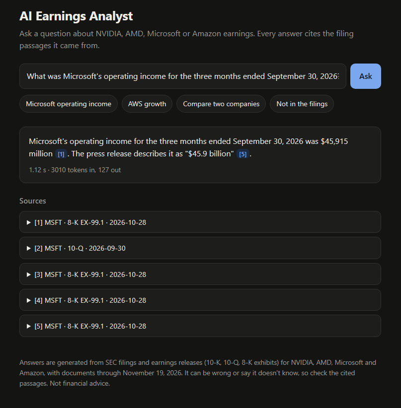
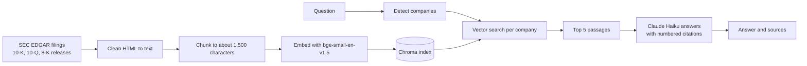

# AI Earnings Analyst

Ask plain-English questions about NVIDIA, AMD, Microsoft and Amazon earnings. The app answers from SEC filings and earnings releases, cites the passages it used, and says "I don't know" when the documents don't cover the question.



## What it does

- Answers questions like *"What was Microsoft's operating income for the three months ended September 30, 2026?"* with a figure and a clickable citation to the filing passage.
- Compares companies: *"Which company reported higher total revenue: NVIDIA or Microsoft?"*
- Refuses questions the filings don't answer (for example, Amazon's Prime member count) instead of guessing.
- Ships with an evaluation suite, so every claim below is measured rather than asserted.

## How it works



- **Corpus:** 40 documents (10-Ks, 10-Qs and 8-K earnings-release exhibits) for four companies, through November 19, 2026. 3,408 chunks.
- **Retrieval:** `BAAI/bge-small-en-v1.5` embeddings in a persistent Chroma index with cosine distance. Company routing detects which of the four companies a question names and searches only their chunks, one search per company for comparison questions.
- **Answering:** Claude Haiku sees the five retrieved passages and must answer only from them, cite each claim as `[n]`, and reply "I don't know based on the provided documents." when the passages don't support an answer.
- **API and UI:** a FastAPI backend (`/ask`, with input validation, a per-visitor rate limit and a daily cap) and a single-page web UI that renders citations as links to the source passages.

## Results

Evaluated on two question sets. The original set has 28 hand-written questions: 22 answerable (single facts, exact numbers, cross-company comparisons, multi-section questions) and 6 unanswerable. The held-out set has 23 questions (20 answerable, 3 unanswerable) that the system was never tuned against, described below. Gold evidence is a verbatim substring of the source filing, checked by a validator script. Answers are graded by an LLM judge (Claude Sonnet) that requires the exact figure when the reference gives one. The table below covers the original 28.

| | This system | Same model, no retrieval |
|---|---|---|
| Answerable questions correct | **15/22 (68%)** | 0/22 |
| Unanswerable questions correctly refused | **6/6** | 4/6 (invented answers on 2) |
| Correct when the evidence reached the top 5 | **15/15** | n/a |
| Correct answers that cite a passage containing the evidence | 15/15 | n/a |
| Average latency | 1.8 s | |
| Average tokens per question | about 3,100 in, 300 out | |

Retrieval on the original set: Recall@5 of 69% (20 of 29 gold evidence items in the top 5), MRR 0.47.

The system's failures are retrieval misses, not invented numbers. Of the 7 misses, 3 gave the right figure rounded the way the press release rounds it (for example $2.4 billion instead of $2,428 million, which the strict judge rejects), 2 answered one part of a two-part question and said the other part wasn't in the documents, and 2 refused or couldn't complete the comparison. Counting the 3 rounded answers as correct would give 18/22 (82%). I report that only alongside the strict number, because I judged those three answers by hand after seeing the results. See [docs/metrics.md](docs/metrics.md) for the full measurement history.


### Held-out check

After the retrieval experiments ended, I built a second set the system had never been tuned against: 20 answerable and 3 unanswerable questions. The set was committed to git before the first run and run once, with no label changes afterward.

| | Original 28 | Held-out 23 | Combined 51 |
|---|---|---|---|
| Answerable questions correct | 15/22 (68%) | 12/20 (60%) | **27/42 (64%)** |
| Same model, no retrieval | 0/22 | 1/20 | 1/42 (2%) |
| Unanswerable correctly refused | 6/6 | 3/3 | 9/9 |
| Correct when the evidence reached the top 5 | 15/15 | 10/10 | 25/25 |

The original set was used to choose company routing and to correct labels, so its score is optimistic. The held-out 60% is the better estimate for new questions, with a wide margin of error (20 questions is roughly plus or minus 20 points). The 8 held-out misses were 6 refusals and 2 answers marked incorrect: one gave a correctly rounded figure where the exact table figure was required, and one could not isolate the figure and said so. None contradicted the filings. Exact-number questions were again the weak spot, with 1 of 5 retrieved. Full details are in [docs/metrics.md](docs/metrics.md).

## What I tried

Each change was tested alone against the same frozen question set and kept only if it helped.

| Experiment | Result |
|---|---|
| Company routing (search only the companies named in the question) | **Adopted.** Small gain in ranking |
| Prepend company, document type and date to each chunk before embedding | Worse: Recall@5 fell from 75% to 56% on the first eval set |
| Cross-encoder reranker over 50 candidates | No accuracy gain, added latency |
| Hybrid retrieval (BM25 + vector, reciprocal rank fusion) | Worse: Recall@5 69% to 52% |
| 600-character chunks instead of 1,500 | Much worse for table rows (Recall@5 31%); better for single-sentence answers |
| Filter to documents dated near the period named in the question | No gain in the top 5 (MRR 0.47 to 0.51) |
| `bge-base-en-v1.5` instead of `bge-small-en-v1.5` | Worse (Recall@5 52%), 3x slower to index |
| Prompt change: prefer the exact table figure over a rounded one | No effect: the exact table rows were never retrieved |
| Two-stage retrieval: pick the top documents, then rank chunks inside them (vector + BM25) | Worse: Recall@5 59%, full-hit 12/22 |
| LLM-written context for every chunk, prepended before embedding (Claude Haiku, about $0.78 for 3,408 chunks) | Worse: Recall@5 59%, MRR 0.47 to 0.28 |
| Fuse the plain and contextual indexes | Worse: Recall@5 62%, full-hit 12/22 |

The takeaway: in every failing case the search finds the right document, but the chunk holding the number loses to a better-matching chunk of the same filing. The causes are bare table rows with no company or period, one relevant sentence inside a long chunk, and near-identical quarterly filings. Eight changes to ranking and indexing were tested and only company routing helped, so I stopped there and wrote up the diagnosis in [docs/metrics.md](docs/metrics.md). The remaining idea is structured extraction of the financial statements, answered through function calling.

## Known limitations

- Exact figures from financial-statement tables are sometimes not retrieved; the model then gives the rounded figure from the earnings-release text or says it doesn't know.
- A few 10-K facts (for example, the employee count) are missed.
- Company detection is a hard-coded keyword list for four companies. Other companies are not supported.
- Nearly all eval questions name an explicit date, so vague questions like "last quarter" are lightly tested.
- The eval sets are small (28 original questions, 20 answerable held-out questions), so scores carry a margin of error of roughly 10 to 20 points.
- The corpus is a fixed snapshot (documents through 2026-11-19); no earnings call transcripts.
- Not financial advice. Answers can be wrong; check the cited passages.

## Run it locally

Requires Python 3.13 (earlier versions probably work), an Anthropic API key, and a contact string for the SEC, which requires an identifying `User-Agent`.

```bash
git clone https://github.com/dannyo17/earnings-analyst.git
cd earnings-analyst
python -m venv .venv
# Windows: .venv\Scripts\Activate.ps1      macOS/Linux: source .venv/bin/activate
pip install -r requirements.txt
```

Create a `.env` file in the project root (it is gitignored):

```
ANTHROPIC_API_KEY=your-key-here
SEC_USER_AGENT=Your Name your.email@example.com
```

Build the index (downloads filings from SEC EDGAR, cleans them, chunks them, embeds them; takes about 10 minutes):

```bash
python src/download_filings.py
python src/process_filings.py
python src/build_chunks.py
python src/build_index.py
```

Run the app and open http://127.0.0.1:8000:

```bash
python -m uvicorn --app-dir src api:app --port 8000
```

Run the evaluation:

```bash
python evals/validate_questions.py   # checks that every gold evidence string exists in the filings
python src/eval_retrieval.py routed  # retrieval metrics
python src/eval_answers.py routed    # end-to-end answers graded by an LLM judge
```

## Deployment

A `Dockerfile` and `requirements-deploy.txt` are included for CPU hosting (CPU-only PyTorch, the embedding model baked in at build time, non-root user, port 7860). The dependency list was verified in a clean virtual environment; the image itself has not been built yet. It expects the prebuilt `data/chroma` index and an `ANTHROPIC_API_KEY` environment variable. The API limits each visitor to 10 questions per 10 minutes and the service to 300 per day (configurable through environment variables).

## Project layout

| Path | What it holds |
|---|---|
| `src/download_filings.py`, `process_filings.py`, `clean_filing.py` | Download from SEC EDGAR and convert filings to clean text |
| `src/chunking.py`, `build_chunks.py`, `build_index.py` | Chunking and the Chroma index |
| `src/search.py`, `answer.py`, `llm.py` | Retrieval (baseline, routed and experimental modes), answering, Claude client |
| `src/api.py`, `web/index.html` | FastAPI backend and web UI |
| `evals/questions.jsonl`, `src/eval_retrieval.py`, `src/eval_answers.py` | Question set and the two evaluation scripts |
| `docs/metrics.md` | Every measurement and experiment, with before and after numbers |

## Data

All data is public SEC filings and earnings releases. They are not committed to this repository: the download script fetches them.